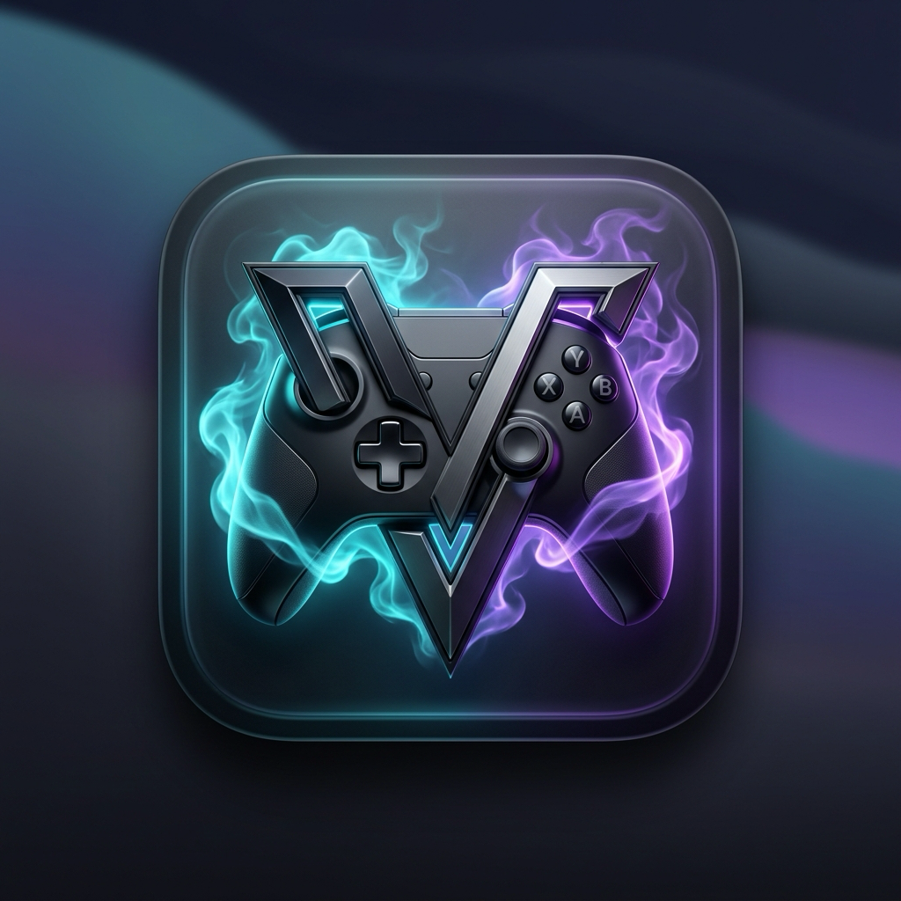

<div align="center">



# 🎮 Vapor
### Zero-Limit Windows Gaming Engine for macOS (Apple Silicon)

[-black?logo=apple)](https://github.com/Sameer-Runza23/vapor)
[](https://github.com/Sameer-Runza23/vapor)
[](LICENSE)
[](https://github.com/Sameer-Runza23/vapor)

**Vapor** is a free, open-source alternative to CrossOver for Apple Silicon Macs. Run Windows Steam, DirectX 11, and DirectX 12 games directly on macOS with zero subscription costs, no trial limits, and no virtual machine overhead.

[Quick Install](#-quick-install) • [Tested Games](#-tested-games--performance) • [CLI Commands](#-cli-commands) • [Troubleshooting](#-troubleshooting)

</div>

---

## ⚡ Highlights

* **100% Free & Standalone:** No 14-day trial timers, no background license daemons, and zero subscription fees.
* **Apple D3DMetal 2 (Game Porting Toolkit 2):** DirectX 11 and DirectX 12 calls translate natively into Apple Metal 3 GPU queues with high frame rates.
* **MSYNC & Fast Mutex Synchronization:** Ultra-low latency thread synchronization tailored for Apple Silicon cores.
* **VAC-Compliant Clean Mode:** Launches official Windows Steam without memory injectors or blocked binaries, verified for Counter-Strike 2 official matchmaking.
* **Live Apple Metal Performance HUD:** View real-time FPS, frame time graphs, and GPU VRAM allocation with a single toggle.
* **Native SwiftUI GUI & CLI:** Use either the desktop macOS app or the powerful command-line interface.

---

## 🚀 Quick Install

### Option 1: One-Line Terminal Installer (Recommended)
Open Terminal and run:

```bash
curl -fsSL https://raw.githubusercontent.com/Sameer-Runza23/vapor/main/install.sh | bash
```

The script will automatically check for Apple Silicon, verify Rosetta 2, set up the Wine-CX + D3DMetal engine, and install both the `vapor` CLI and the desktop app into `/Applications`.

### Option 2: Drag-and-Drop (`.dmg`)
Download the latest `Vapor-macOS-AppleSilicon.dmg` from the [Releases](https://github.com/Sameer-Runza23/vapor/releases) page and drag **Vapor.app** into your `/Applications` folder.

---

## 🎮 Tested Games & Performance

| Game | Tested Mac Model | Settings | Average FPS | Status |
| :--- | :--- | :--- | :--- | :--- |
| **Counter-Strike 2 (CS2)** | Mac mini M2 Pro (16GB) | 1080p Medium • FSR Quality | **140 – 165 FPS** | 🟢 Verified & VAC Secure |
| **Grand Theft Auto V** | MacBook Pro M1 Max | 1080p Very High • DX11 | **75 – 95 FPS** | 🟢 Smooth Playable |
| **Cyberpunk 2077** | MacBook Pro M3 Pro | 1080p Low/Medium • FSR 2.1 | **45 – 60 FPS** | 🟢 Playable |
| **The Witcher 3: Wild Hunt** | Mac mini M2 Pro | 1080p High • DX12 | **55 – 70 FPS** | 🟢 Playable |

> *To report performance results for additional games, please see [CONTRIBUTING.md](CONTRIBUTING.md).*

---

## 🛠️ CLI Commands

Once installed, the `vapor` command is globally accessible in Terminal:

```bash
# Launch Windows Steam with Apple Metal 3 acceleration
vapor steam

# Direct launch Counter-Strike 2
vapor cs2

# Run any standalone Windows installer or game .exe
vapor run ~/Downloads/GameSetup.exe

# Toggle the Apple Metal FPS & Performance HUD overlay
vapor hud on      # Show live FPS in games
vapor hud off     # Hide overlay
vapor hud status  # Check current HUD state

# Manage Wine configurations and processes
vapor winecfg     # Open Wine configuration GUI (Windows version, audio, DPI)
vapor taskmgr     # Open Windows Task Manager to monitor CPU & RAM
vapor kill        # Force close any stuck background processes

# Launch native desktop app
vapor gui
```

---

## 💻 System Requirements

* **Computer:** Any Apple Silicon Mac (M1, M1 Pro/Max/Ultra, M2, M3, M4 series).
* **Operating System:** macOS Sonoma 14.0+ or macOS Sequoia 15.0+ recommended.
* **RAM:** 8GB minimum (16GB+ strongly recommended for modern 3D games).
* **Rosetta 2:** Required to translate x86_64 Windows binaries:
  ```bash
  softwareupdate --install-rosetta --agree-to-license
  ```

---

## ❓ Troubleshooting

### 1. Game Stutter or Low FPS during First Launch
DirectX 11/12 shaders compile just-in-time into Apple Metal shaders on first encounter. After 2–3 minutes of gameplay, shader caching stabilizes and frame rates remain smooth.

### 2. Steam UI Appears Black or Blank
Vapor launches Steam with the `-no-cef-sandbox` flag by default. If Steam UI is still blank, ensure you are running `vapor steam` rather than opening the executable directly.

### 3. Stuck Game Process
If a game crashes in the background and locks the audio or bottle, execute:
```bash
vapor kill
```

---

## ⚖️ Legal & Disclaimer

* **Vapor** is an independent open-source project and is not affiliated with, endorsed by, or sponsored by Valve Corporation, Apple Inc., or CodeWeavers Inc.
* Steam and the Steam logo are trademarks and/or registered trademarks of Valve Corporation.
* macOS, Apple Silicon, and Metal are trademarks of Apple Inc.
* Wine is licensed under the GNU Lesser General Public License (LGPL v2.1+).

---

## 📄 License

This project is licensed under the [MIT License](LICENSE).
